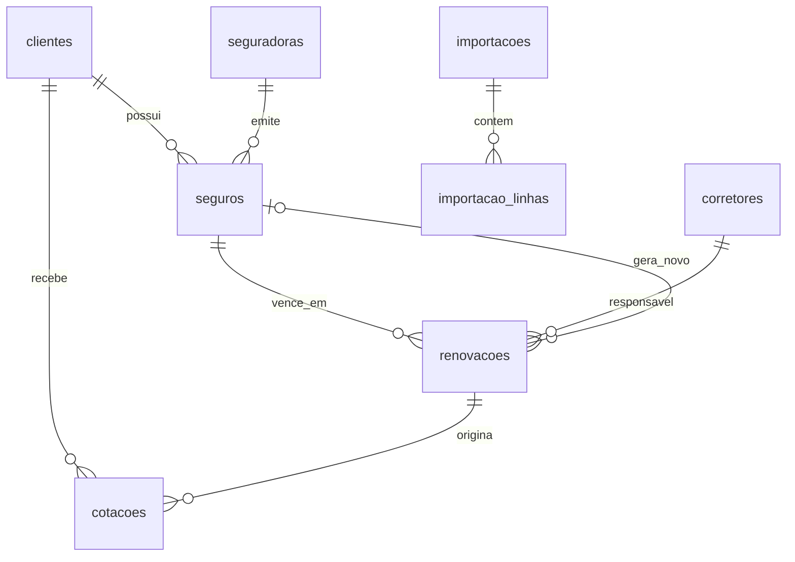

# Modelo de dados — CRM

> Status: **implementado** em `supabase/migrations/20261017000200_modelo_renovacoes.sql`. Diferenças em relação ao texto abaixo: `clientes.documento` virou `cpf_cnpj`; `seguros.numero_apolice` vem da tabela antiga; `importacoes` ganhou `aba` e `importado_por_nome`; `clientes` ainda tem campos extras (`tipo`, `endereco`, `consentimento_lgpd_em`) da migration inicial.

## Princípios

- **Um cliente, vários seguros.** Clientes únicos ≠ quantidade de seguros.
- **Não duplicar clientes na importação.** Chave preferencial: CPF/CNPJ. Sem ele, usar o nome normalizado e mandar as possíveis duplicatas para revisão humana.
- **Toda linha importada é rastreável** até o arquivo e a linha de origem, para auditoria e reimportação.
- **Agnóstico de ramo.** Residencial é o foco das telas, não do esquema.
- **Pronto para cotação.** `cotacoes` já existe para que a cotação automática futura grave no mesmo lugar.

## Diagrama

## Tabelas

### clientes
| Campo | Tipo | Notas |
| --- | --- | --- |
| id | uuid PK | |
| nome | text | Como veio na planilha |
| nome_normalizado | text, índice | Minúsculo, sem acentos ou espaços duplos; usado na deduplicação |
| cpf_cnpj | text, unique, nullable | Só dígitos. Nulo enquanto a base de clientes não for importada |
| telefone, email | text, nullable | |
| origem | enum: `carteira`, `indicacao`, `marketing` | `marketing` é para o fluxo futuro |
| criado_em, atualizado_em | timestamptz | |

### seguradoras
| Campo | Tipo | Notas |
| --- | --- | --- |
| id | uuid PK | |
| nome | text unique | Nome canônico: "Porto Seguro" |
| apelidos | text[] | Variações vistas nas planilhas: "Porto", "PORTO SEGURO" |

### corretores
| Campo | Tipo | Notas |
| --- | --- | --- |
| id | uuid PK | |
| nome | text | |
| sigla | text unique | Como aparece na planilha. Carga inicial: R = Renata, C = Carlos; D = Dani (migration 000600) |

### seguros (apólices)
| Campo | Tipo | Notas |
| --- | --- | --- |
| id | uuid PK | |
| cliente_id | FK clientes | |
| seguradora_id | FK seguradoras | |
| ramo | enum: `residencial`, `auto`, `vida`, `outro` | |
| numero_apolice | text, nullable | Não vem na planilha atual |
| inicio_vigencia, fim_vigencia | date | `fim_vigencia` = coluna Vigência |
| premio_liquido, valor_parcela | numeric, nullable | Hoje vêm vazios |
| comissao_pct | numeric(5,2), nullable | Percentual (ex.: 15.00 = 15%) |
| parcelas | int, nullable | |
| situacao | enum: `ativo`, `renovado`, `nao_renovado`, `cancelado` | |

### renovacoes
Uma linha da planilha de renovações = um registro aqui.

| Campo | Tipo | Notas |
| --- | --- | --- |
| id | uuid PK | |
| seguro_id | FK seguros | Apólice que está vencendo |
| vencimento | date | |
| corretor_id | FK corretores | |
| status | enum: `pendente`, `cotando`, `renovada`, `nao_renovada` | Único campo editado no dia a dia |
| cotada | bool | |
| seguradora_fechada_id | FK seguradoras, nullable | "Seguradora Atual" |
| seguro_novo_id | FK seguros, nullable | Apólice gerada pela renovação |
| valor_recebido | numeric, nullable | |

Unicidade: `(seguro_id, vencimento)`. Garante que reimportar a mesma planilha não duplique.

### cotacoes
| Campo | Tipo | Notas |
| --- | --- | --- |
| id | uuid PK | |
| cliente_id | FK clientes | |
| renovacao_id | FK renovacoes, nullable | Nulo para cliente novo |
| ramo | enum | |
| seguradora_id | FK seguradoras | |
| premio | numeric, nullable | |
| origem | enum: `manual`, `multicalculo`, `automatica` | `automatica` só quando houver integração validada |
| status | enum: `cotada`, `enviada`, `aceita`, `recusada` | |

No MVP essa tabela pode ficar vazia. Ela existe para a ficha do cliente e para a fase de cotação.

### importacoes / importacao_linhas
| Campo | Tipo | Notas |
| --- | --- | --- |
| importacoes.id | uuid PK | |
| modelo | text | Ex.: `renovacoes_consolidada_v1`, depois `porto_v1`, `tokio_v1` |
| mes_referencia | date | 1º dia do mês da planilha (há uma planilha por mês) |
| arquivo_nome, importado_por, importado_em | | |
| linhas_ok, linhas_erro, linhas_revisao | int | |
| importacao_linhas.dados_brutos | jsonb | A linha original, como veio |
| importacao_linhas.status | enum: `ok`, `erro`, `revisao` | |
| importacao_linhas.mensagem | text | Motivo do erro ou da revisão |
| importacao_linhas.renovacao_id | FK, nullable | Registro criado ou atualizado |

## Deduplicação na importação

1. Se a linha tem CPF/CNPJ → procura por `cpf_cnpj`.
2. Se não tem → procura por `nome_normalizado`.
   - 1 resultado: vincula.
   - 0 resultados: cria o cliente.
   - Mais de 1 resultado: linha vai para `revisao`, sem gravar nada. É raro: segundo a equipe, o mesmo nome em várias linhas é o mesmo cliente com seguros de ramos diferentes.
3. A base de clientes está sendo carregada direto no Supabase (stand-by deste lado). A tabela `clientes` acima deve ser alinhada com a que está sendo criada lá, não duplicada. Quando ela estiver pronta com CPF, os clientes criados só pelo nome recebem o CPF (`update`), sem criar outro registro.

## Modelos de importação

Cada formato de planilha é um "modelo": um mapeamento coluna → campo mais opções (formato de data, ramo e corretor padrão), na tabela `modelos_importacao` (um por seguradora; `seguradora_id` nulo = planilha da corretora). Guarda só nomes de colunas, nenhum dado de cliente. A importação inteira é gravada pela função `importar_lote` numa transação. Detalhes em [apps/web/README.md](../../apps/web/README.md#importação-de-planilhas).

## Segurança e LGPD

- Row Level Security no Supabase: só usuários autenticados da equipe leem e escrevem.
- `dados_brutos` contém dados pessoais e segue a mesma regra de acesso.
- Nenhum dado real em seeds, testes ou fixtures.
